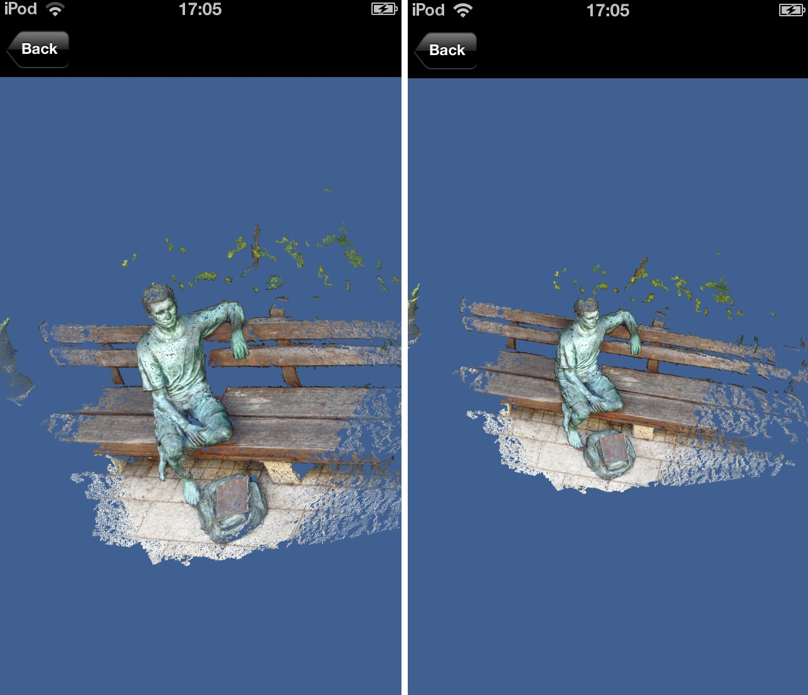

# Multi-view reconstruction for iPhone

The student project collected phone photographs, uploaded them to a reconstruction server and returned a coloured PLY point cloud for viewing.

Original project: **Mohamad Jabareen and Mostafa Agbariah**. Supervision: **Aaron Wetzler**.

*Historical iPhone viewer image, separate from the new reconstruction results.*

The historical image and redacted presentation are available; original client/server code is missing. A separate Python implementation now uses COLMAP for camera estimation and sparse geometry, with optional OpenCV pairwise stereo and a browser client.

## Updated

**[Open the browser demo](https://twerdster.github.io/iphone-multiview-reconstruction/)** · [Updated guide](updated/README.md)

The hosted Canvas viewer rotates saved Avignon sparse and TUM stereo geometry. It does not reconstruct in the browser. A separate Python/COLMAP/OpenCV implementation accepts photographs and produces sparse and optional partial stereo clouds through a local server. Its output has arbitrary scale and is not a mesh or a surface-accuracy result.

[Install and reconstruct (Python 3.12)](updated/DETAILS.md) · [Viewer controls](updated/demo/README.md) · [Validation](updated/validation/README.md)

## Project record and rights

The presentation was redacted after an earlier credential exposure; [the project record](PROJECT_RECORD.md#historical-credential-exposure) explains its scope. Avignon-derived geometry is CC BY-NC 3.0 (noncommercial); TUM-derived geometry is CC BY 4.0.

[Historical context, attribution and recovery details](PROJECT_RECORD.md) preserve the earlier record. Original material, datasets, dependencies and new code keep their separately stated terms; no blanket license is added.
