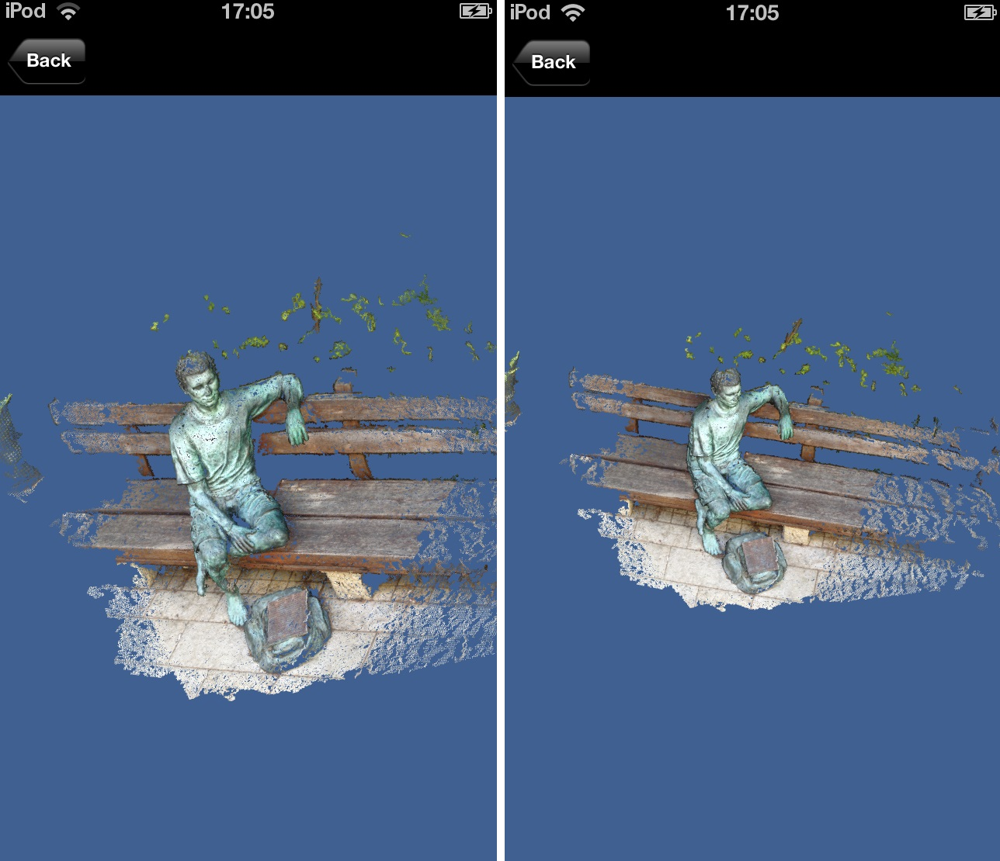

# Multi-View 3D reconstruction application for iPhone

  

An iPhone capture application with a server-side multi-view 3D reconstruction pipeline (PMVS2 in the earlier project description; VisualSFM in the recovered slides).

Students: Mohamad Jabareen, Mostafa Agbariah.

Supervision: Aaron Wetzler.

## Status

The [16-slide project presentation](docs/slides.pdf), *3D Scanning framework for iPhone*, has been recovered. The public copy has one database screenshot removed from slide 7 to protect login details and personal data; the other slides are unchanged. **Source code coming soon:** the full capture/server/viewer implementation has not yet been located. This is not a runnable release.

The first recovered PDF committed on November 12, 2026 contained that screenshot. Replacing the current PDF does not remove historical Git copies. The authenticity and continued validity of the displayed application login records have not been established; any real or reused credentials must be changed by their owners.

## Original code

Original application and server source has not been located for this archive yet. This does not mean the code no longer exists; it will be added under `source/` only after it is recovered and reviewed. The recovered [presentation](docs/slides.pdf) is currently the primary project document.

## Running

The recovered slides describe iPhone image capture/upload, server-side VisualSFM reconstruction and PLY output, and KiwiViewer integration on the phone. The earlier project description names PMVS2; the exact final integration revision has not been established. No server deployment or Xcode build instructions are invented without the corresponding source. Signing configuration and historical cloud/server accounts must be replaced with a user's own setup when recovery is complete.

## Links

- [Project entry on Aaron Wetzler's website](https://twerdster.github.io/#multi-view-3d-reconstruction-application-for-iphone)

## Attribution and Updates

Original student and third-party attribution will be retained. No license for unrecovered source code is implied by this README. Original authors can open an issue to contribute updates or request corrections or removal of their material.

Figure provenance: `assets/project-preview.jpg` is the original student-project figure from the archived project page on Aaron Wetzler's website, copied without modification. It is a historical figure, not a new reconstruction result.
