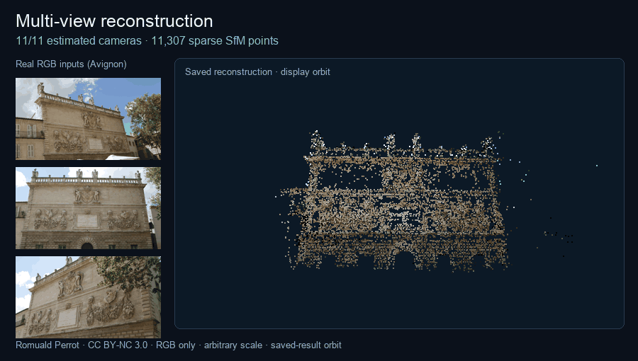

# iPhone multi-view reconstruction: updated implementation

## Updated and ported for modern hardware

This is a **new implementation of the documented workflow**, built because the original iPhone client and server source have not been recovered. A browser accepts phone photographs or an image ZIP, a local Python server estimates camera poses and reconstructs a coloured point cloud, and an interactive browser viewer displays the PLY result. CPU COLMAP replaces the historical VisualSFM stage; a limited OpenCV stereo stage produces a separate partial stereo cloud, and the browser viewer replaces KiwiViewer.



*Saved sparse result from 11 real Avignon photographs by Romuald Perrot, [CC BY-NC 3.0](https://creativecommons.org/licenses/by-nc/3.0/). The orbit changes the display view only; it is not live capture or a mesh. [Download the sparse PLY](results/avignon-sparse.ply) or read the [media provenance](assets/PROVENANCE.md).*

[Watch the working browser flow: upload, reconstruct, switch clouds and download PLY](assets/browser-workflow.mp4) (31 seconds, 0.74 MB). [Additional TUM RGB-only result](assets/reconstruction.gif).

The original [presentation](../docs/slides.pdf) and [historical image](../assets/project-preview.jpg) are preserved. The code in this directory was written in 2026 and is not the students' original implementation.

## Run it

Use **Python 3.12** on macOS or Linux. No CUDA GPU, account, cloud service or model download is required.

```bash
cd updated
python3.12 -m venv .venv
source .venv/bin/activate
python -m pip install -r requirements.txt
python -m multiview.server --work-dir "$HOME/multiview-runs"
```

Open the complete URL printed by the server, including its `#token=` access code. Select 12–30 overlapping JPEG/PNG photographs, press **Reconstruct**, then drag the point cloud to rotate it. Scroll or pinch to zoom. The **Cloud** selector switches between sparse SfM and filtered stereo, when available. **Final PLY** and **Sparse PLY** save their respective full results; **Run details** saves measured counts and configuration.

For an iPhone or another device on the same trusted Wi-Fi network, start with `--host 0.0.0.0`, replace `0.0.0.0` in the printed URL with the computer's LAN address, and retain the token fragment. **Take a photo** opens the browser's camera file picker; **Choose photos** opens its photo library. Processing runs on the Mac/Linux server. This is a browser client, not a rebuilt native iOS app. Desktop Chrome and a phone-sized Chrome viewport were tested; physical iPhone/Safari capture and pinch gestures have not been validated. HTTP on a LAN is unencrypted; keep this local development server on a trusted network.

On iPhone, use Camera → Formats → **Most Compatible**, or export HEIC photos as JPEG before selecting them. HEIC is rejected with an explanation rather than silently omitted.

A reproducible real-photo example downloads 11 pinned, SHA-256-verified Avignon photographs (159,255,983 bytes, about 152 MiB). Its **CC BY-NC 3.0 noncommercial data license** is separate from the MIT code license:

```bash
python tools/download_demo.py /path/to/avignon-images
python -m multiview /path/to/avignon-images /path/to/new-avignon-run
```

For direct processing without the browser:

```bash
python -m multiview /path/to/photos /path/to/new-run --threads 4
# Or: python -m multiview /path/to/photos.zip /path/to/new-run
# Add --sparse-only to skip the optional stereo stage.
python -m pytest -q
```

The output directory must be new. Each run writes normalized photographs, input hashes, a COLMAP database and model, sparse and final PLY files, estimated cameras, a run summary and machine-readable status. Keep virtual environments, SQLite databases and run workspaces on a native filesystem; copy completed large outputs to an external drive if desired. Remove unneeded run directories yourself; the server does not delete results automatically.

## What the pipeline does

1. Import 3–80 distinct JPEG/PNG images from uploaded files, a folder or a ZIP. Check decoded image sizes, normalize EXIF orientation, resize to at most 1600 pixels on the long side, remove metadata and record input/normalized SHA-256 hashes. ZIP entries are read without extracting their paths.
2. Extract SIFT descriptors on the CPU, exhaustively match image pairs, and verify two-view geometry with COLMAP 3.13.0. Use a shared `SIMPLE_RADIAL` camera when image dimensions agree; otherwise use COLMAP's automatic camera grouping. Intrinsics begin from COLMAP's image-size heuristic and are refined during reconstruction.
3. Run incremental structure from motion: estimate camera poses, triangulate consistent feature tracks and bundle adjust. Select the largest returned model; other models are retained in `sparse/`. A result requires at least three registered views and 30 sparse points.
4. Optionally select up to 20 overlapping candidate stereo pairs with 2–30° estimated viewpoint separation. At a maximum 960-pixel long side, OpenCV StereoSGBM uses the **estimated** cameras, a one-pixel left/right consistency check, texture/depth filters and two-pixel sampling. Skip unsupported image dimensions or rectification axes/signs and record the reason. Merge the accepted samples with voxel deduplication. If no stereo samples survive, return the sparse cloud and identify it as such.
5. Keep `sparse.ply` and optional `stereo.ply` separate. `result.ply` is the stereo cloud when stereo succeeds, otherwise the sparse cloud; it is not their union. Write coloured ASCII PLY and bounded JSON previews. The dependency-free WebGL viewer shows up to 120,000 points; the PLY contains every output point. Browser rotation changes only the view, not the reconstruction.

The stereo stage is pairwise SGBM, **not COLMAP PatchMatch, PMVS2, a full multi-view stereo consistency solver or a mesh generator**. It can add noisy or incomplete surfaces. Sparse and stereo outputs are kept separately.

## Validation

A real-image check uses 24 RGB photographs from TUM `freiburg1_xyz`. Reconstruction receives **RGB images only**: neither Kinect depth nor recorded camera poses are supplied. On both the tested Mac and Linux machine, all 24 views registered, producing roughly 4,000 sparse points and 45,000–49,000 filtered stereo points. A second scene, the Avignon facade, registered all 11 images. Full commands, exact run counts, timing, input hashes and independent camera-trajectory evaluation are in [the validation record](validation/README.md).

The automated suite checks bounded imports, duplicate rejection, ZIP traversal rejection, malformed uploads, access control, job-lock recovery, camera projection and coordinate transforms. These tests do not establish general photogrammetry accuracy. The real-data run checks that the actual COLMAP/SGBM chain produces a result; a fitted-scale camera-trajectory comparison does not measure surface error.

## Capture guidance and limitations

Photograph a **static, textured** scene under steady light. Move around it with substantial overlap and visible translation. Pure rotation, blank walls, repeated patterns, reflections, moving objects and motion blur can prevent reconstruction or produce wrong matches. Keep the same camera, lens and zoom throughout a collection; mixing cameras at the same image dimensions can violate the shared-camera assumption.

Scale is arbitrary until an external length or pose reference is supplied. There is no claim of metric surface accuracy, watertight geometry, live tracking or realtime reconstruction. Some photographs may not register; separate model fragments are not automatically aligned. The stereo stage skips vertical baselines and may return no points for difficult pairs. Large archives are bounded to 256 MB, photographs to 24 MB/40 megapixels each, and server jobs to 15 minutes. One server job runs at a time. Normal server shutdown (Ctrl-C or SIGTERM) terminates its active reconstruction worker and marks an unfinished job failed. A forced process kill or power loss cannot guarantee cleanup; check for a surviving worker before launching another job. Server restart is not a job-resume mechanism. Inspect `status.json`/`worker.log` on failure.

## Attribution and licenses

Historical project: Mohamad Jabareen and Mostafa Agbariah, supervised by Aaron Wetzler. The recovered project material documents the architecture but supplies no source to repair.

New implementation: Aaron Wetzler, 2026, with agent assistance; [MIT license](LICENSE) for the new code. COLMAP/pycolmap and OpenCV are third-party numerical engines, not student code. See the [dependency and data references](REFERENCES.md) for their licenses, documentation and TUM attribution. The new-code license does not license the recovered presentation/image or third-party data.
