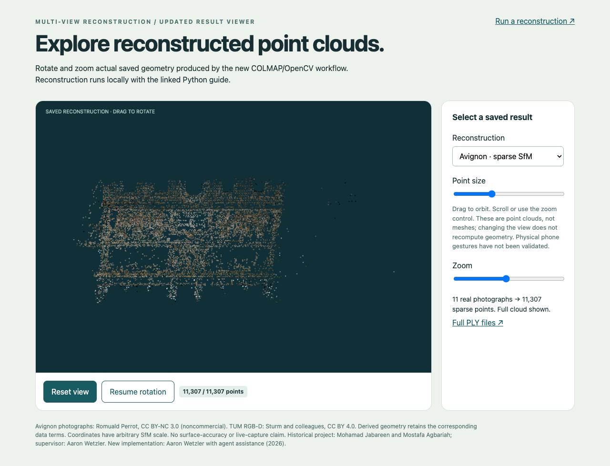

# Multi-view reconstruction for iPhone: updated work

## Updated work

**[Open the browser demo](https://twerdster.github.io/iphone-multiview-reconstruction/)**

The **interactive cloud viewer** opens saved Avignon and TUM reconstructions from the new pipeline. It rotates existing geometry; new reconstruction requires the local Python server. The output is an incomplete point cloud at arbitrary scale, not a mesh or a measured surface-accuracy result.

[Browser demo guide](demo/README.md) describes local use, checks and limitations.

[Detailed implementation, setup and recorded results](DETAILS.md).

Historical project: Mohamad Jabareen and Mostafa Agbariah; supervision: Aaron Wetzler. New implementations are labeled separately and do not change the preserved materials.

*Actual Chrome interface capture. Its input and execution scope are described above and in the demo guide.*
